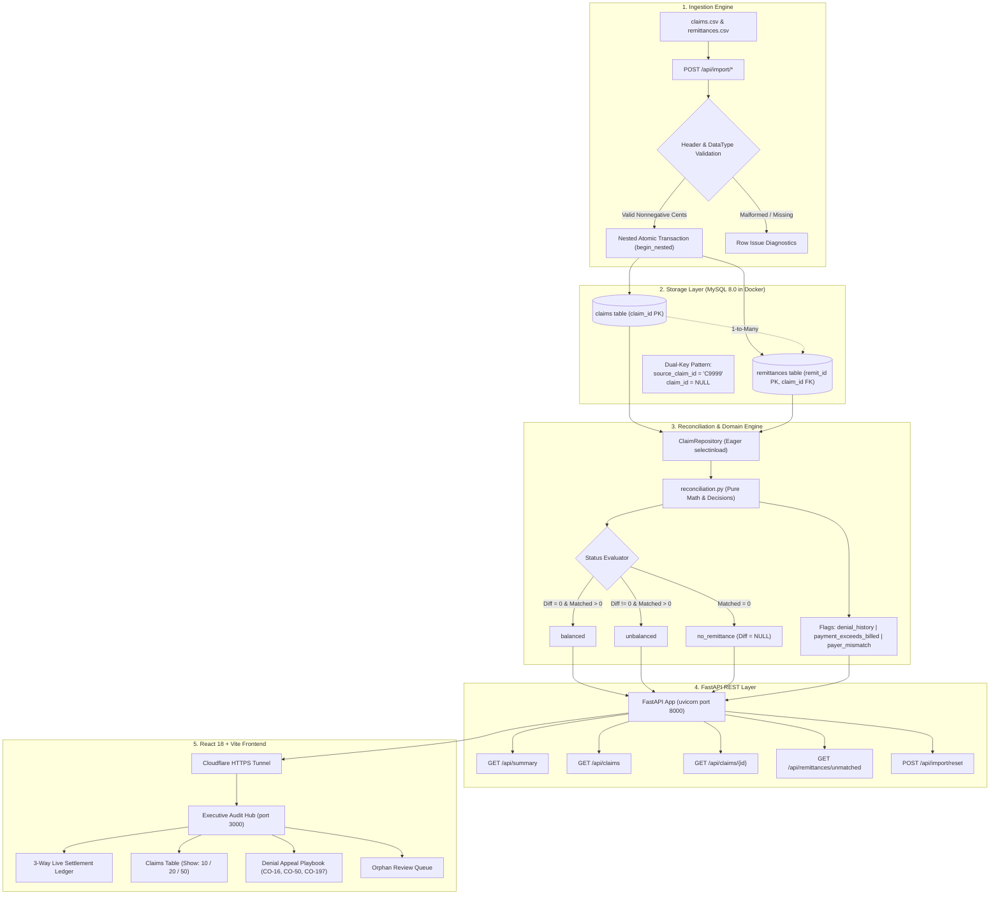

# Stitch Financial — Claim Reconciliation Platform
# The Comprehensive Interview Master Guide: From Scratch to Advanced

> **Author**: Nakul (Forward Deployed Engineer Candidate)  
> **Live Demo**: [https://fairfield-reduction-penny-housewares.trycloudflare.com](https://fairfield-reduction-penny-housewares.trycloudflare.com)  
> **GitHub Repository**: [https://github.com/nakul143naps/claim-reconciliation](https://github.com/nakul143naps/claim-reconciliation)  
> **Test Suite**: 38 of 38 Unit, Integration, and Scale Tests Passing (100%)

---

## Table of Contents
1. [Executive Summary & 30-Second Pitch](#1-executive-summary--30-second-pitch)
2. [Healthcare Domain Basics (Claims vs. Remittances in Plain English)](#2-healthcare-domain-basics)
3. [The Complete System Architecture](#3-the-complete-system-architecture)
4. [Database Deep Dive & Everything MySQL](#4-database-deep-dive--everything-mysql)
5. [Top 20 SQL Queries You Might Be Asked (With Code & Explanations)](#5-top-20-sql-queries-interviewers-might-ask)
6. [Crucial Core Functions (With Real Code Snippets)](#6-crucial-core-functions)
7. [All 10 API Endpoints (With Request/Response Code)](#7-all-10-api-endpoints)
8. [Frontend UI & Component Architecture](#8-frontend-ui--component-architecture)
9. [Edge Cases & How We Solved Them](#9-edge-cases--how-we-solved-them)
10. [Senior FDE Defense: Scaling, EDI 835/837, & Security](#10-senior-fde-defense-scaling-edi--security)

---

## 1. Executive Summary & 30-Second Pitch

### Verbatim Opening Statement:
> *"I built an enterprise-grade medical claims reconciliation and revenue integrity platform for Stitch Fin. In healthcare, clinics bill claims to payers and receive complex remittances containing payments, contractual write-offs, and denial codes.*
>
> *I designed this platform on four production principles:*
> 1. *Strict financial precision using integer-cent arithmetic (`BIGINT`) with zero floating-point drift.*
> 2. *Relational foreign-key integrity using a Dual-Key Pattern to safely quarantine orphaned remittances without losing cash accountability or creating phantom accounts receivable.*
> 3. *Real-world operational flexibility with drag-and-drop CSV batch ingestion, automatic bi-directional orphan re-linking, and a 1-click safety reset.*
> 4. *Scale-tested pagination engine with 38 automated unit, integration, and property-based tests.*
>
> *The entire system is running live right now on a Cloudflare Tunnel with an interactive React UI, FastAPI backend, and MySQL 8.0 database."*

---

## 2. Healthcare Domain Basics

If the interviewer asks: *"Explain how medical billing works and why this tool is needed."*

* **The Bill (`Claim` / 837 transaction)**:
  A healthcare provider renders medical services (e.g. CPT code `99214` - Office Visit) and bills the payer (e.g. Northwind Health) for $220.00.
* **The Payment & Advice (`Remittance` / 835 transaction)**:
  The payer doesn't just send a check for $220.00. They send an electronic remittance statement dividing the bill into 4 components:
  1. **Paid Cash (`paid_cents`)**: The actual cash the insurer transfers to the clinic's bank.
  2. **Contractual Adjustment (`adjustment_cents`)**: The negotiated discount (e.g., code `CO-45`). The clinic writes this off and cannot bill anyone for it.
  3. **Patient Responsibility (`patient_responsibility_cents`)**: The patient's copay (`PR-3`) or deductible (`PR-1`). The clinic must collect this from the patient.
  4. **Difference / Balance (`difference_cents`)**: What remains unsettled.
* **The Mathematical Invariant**:
  $$\text{Difference} = \text{Billed} - \text{Paid} - \text{Adjustments} - \text{Patient Responsibility}$$
  When $\text{Difference} = 0$, the claim is **`balanced`**. When $\text{Difference} \neq 0$, it is **`unbalanced`**.

---

## 3. The Complete System Architecture



---

## 4. Database Deep Dive & Everything MySQL

### 4.1 Table Definitions & DDL
The database schema is strictly normalized and enforced in [`backend/app/db/models.py`](file:///C:/Users/rahul/OneDrive/Desktop/rules_project/claim_reconciliation_docs/backend/app/db/models.py):

#### Table: `claims`
```sql
CREATE TABLE claims (
    claim_id VARCHAR(20) NOT NULL PRIMARY KEY,
    patient_account VARCHAR(50) NOT NULL,
    payer VARCHAR(100) NOT NULL,
    service_date DATE NOT NULL,
    cpt VARCHAR(10) NOT NULL,
    billed_cents BIGINT NOT NULL,
    CONSTRAINT chk_claims_billed_cents_nonnegative CHECK (billed_cents >= 0),
    INDEX ix_claims_payer (payer)
) ENGINE=InnoDB DEFAULT CHARSET=utf8mb4 COLLATE=utf8mb4_unicode_ci;
```

#### Table: `remittances`
```sql
CREATE TABLE remittances (
    remit_id VARCHAR(20) NOT NULL PRIMARY KEY,
    source_claim_id VARCHAR(20) NOT NULL,
    claim_id VARCHAR(20) DEFAULT NULL,
    payer VARCHAR(100) NOT NULL,
    paid_cents BIGINT NOT NULL,
    adjustment_cents BIGINT NOT NULL,
    patient_responsibility_cents BIGINT NOT NULL,
    reason_code VARCHAR(30) DEFAULT NULL,
    posted_date DATE NOT NULL,
    CONSTRAINT fk_remittances_claim_id FOREIGN KEY (claim_id) 
        REFERENCES claims(claim_id) ON DELETE SET NULL,
    CONSTRAINT chk_remit_paid_cents_nonnegative CHECK (paid_cents >= 0),
    CONSTRAINT chk_remit_adj_cents_nonnegative CHECK (adjustment_cents >= 0),
    CONSTRAINT chk_remit_patient_resp_nonnegative CHECK (patient_responsibility_cents >= 0),
    INDEX ix_remittances_source_claim_id (source_claim_id),
    INDEX ix_remittances_claim_id (claim_id),
    INDEX ix_remittances_posted_date_remit_id (posted_date, remit_id)
) ENGINE=InnoDB DEFAULT CHARSET=utf8mb4 COLLATE=utf8mb4_unicode_ci;
```

### 4.2 Why These Constraints Matter:
1. **`BIGINT` instead of `FLOAT` or `DECIMAL`**:
   - Storing cents ($150.00 = `15000`) prevents IEEE 754 precision errors.
   - `BIGINT` provides exact integer arithmetic at MySQL CPU-register speed with zero rounding issues.
2. **`CHECK (cents >= 0)` Constraints**:
   - Reversals and negative values are rejected at the database level so bad data can never corrupt the ledger.
3. **`ON DELETE SET NULL`**:
   - If a claim is removed or modified, associated payment advices are not deleted (which would lose cash history); instead, their foreign key is safely unlinked to `NULL`.
4. **Composite Index `(posted_date, remit_id)`**:
   - Remittances for a single claim must be displayed chronologically. This composite index allows MySQL to sort timelines in index-order without creating temporary filesort tables.

---

## 5. Top 20 SQL Queries Interviewers Might Ask

If the interviewer asks: *"Open your terminal or MySQL Workbench/VS Code Database Client and run some queries for me"*, here are the top 20 queries you can run instantly:

### Query 1: Calculate the Reconciliation Balance for Every Claim
```sql
SELECT 
    c.claim_id,
    c.payer,
    c.billed_cents / 100.0 AS billed_dollars,
    COALESCE(SUM(r.paid_cents), 0) / 100.0 AS paid_dollars,
    COALESCE(SUM(r.adjustment_cents), 0) / 100.0 AS adj_dollars,
    COALESCE(SUM(r.patient_responsibility_cents), 0) / 100.0 AS pr_dollars,
    CASE 
        WHEN COUNT(r.remit_id) = 0 THEN NULL
        ELSE (c.billed_cents - COALESCE(SUM(r.paid_cents), 0) - COALESCE(SUM(r.adjustment_cents), 0) - COALESCE(SUM(r.patient_responsibility_cents), 0)) / 100.0
    END AS difference_dollars,
    CASE 
        WHEN COUNT(r.remit_id) = 0 THEN 'no_remittance'
        WHEN (c.billed_cents - COALESCE(SUM(r.paid_cents), 0) - COALESCE(SUM(r.adjustment_cents), 0) - COALESCE(SUM(r.patient_responsibility_cents), 0)) = 0 THEN 'balanced'
        ELSE 'unbalanced'
    END AS calculated_status
FROM claims c
LEFT JOIN remittances r ON c.claim_id = r.claim_id
GROUP BY c.claim_id, c.payer, c.billed_cents
ORDER BY c.claim_id ASC;
```

### Query 2: Find All Unbalanced Claims with Outstanding Variance
```sql
SELECT 
    c.claim_id,
    c.payer,
    c.billed_cents / 100.0 AS billed,
    SUM(r.paid_cents) / 100.0 AS paid,
    (c.billed_cents - SUM(r.paid_cents) - SUM(r.adjustment_cents) - SUM(r.patient_responsibility_cents)) / 100.0 AS variance_dollars
FROM claims c
INNER JOIN remittances r ON c.claim_id = r.claim_id
GROUP BY c.claim_id, c.payer, c.billed_cents
HAVING variance_dollars <> 0;
```
*(Result: 6 claims in benchmark: C1003, C1004, C1006, C1009, C1010, C1011)*

### Query 3: Find Claims with Zero Remittances (`no_remittance`)
```sql
SELECT c.claim_id, c.patient_account, c.payer, c.service_date, c.billed_cents / 100.0 AS billed_dollars
FROM claims c
LEFT JOIN remittances r ON c.claim_id = r.claim_id
WHERE r.remit_id IS NULL;
```
*(Result: C1005 billed for $60.00)*

### Query 4: Balanced Claims that Had an Earlier Denial (`CO-16`, `CO-50`, `CO-197`)
```sql
SELECT c.claim_id, c.payer, c.billed_cents / 100.0 AS billed,
       GROUP_CONCAT(DISTINCT r.reason_code) AS reasons_found
FROM claims c
JOIN remittances r ON c.claim_id = r.claim_id
GROUP BY c.claim_id, c.payer, c.billed_cents
HAVING (c.billed_cents - SUM(r.paid_cents) - SUM(r.adjustment_cents) - SUM(r.patient_responsibility_cents)) = 0
   AND SUM(CASE WHEN r.reason_code IN ('CO-16', 'CO-50', 'CO-197') THEN 1 ELSE 0 END) > 0;
```
*(Result: C1007 — balanced after prior CO-197 denial)*

### Query 5: Detect Overpayment Anomalies (`payment_exceeds_billed`)
```sql
SELECT c.claim_id, c.payer, c.billed_cents / 100.0 AS billed, SUM(r.paid_cents) / 100.0 AS paid,
       (SUM(r.paid_cents) - c.billed_cents) / 100.0 AS overpayment_amount
FROM claims c
JOIN remittances r ON c.claim_id = r.claim_id
GROUP BY c.claim_id, c.payer, c.billed_cents
HAVING SUM(r.paid_cents) > c.billed_cents;
```
*(Result: C1006 — paid $300.00 on a $280.00 bill)*

### Query 6: Calculate Gross Cash Uncollected vs Net AR Variance
```sql
SELECT 
    SUM(c.billed_cents) / 100.0 AS total_billed,
    SUM(r.paid_cents) / 100.0 AS matched_cash_collected,
    (SUM(c.billed_cents) - SUM(r.paid_cents)) / 100.0 AS gross_cash_uncollected,
    SUM(r.adjustment_cents) / 100.0 AS contractual_writeoffs,
    SUM(r.patient_responsibility_cents) / 100.0 AS patient_copays,
    (SUM(c.billed_cents) - SUM(r.paid_cents) - SUM(r.adjustment_cents) - SUM(r.patient_responsibility_cents)) / 100.0 AS net_unsettled_ar
FROM claims c
LEFT JOIN remittances r ON c.claim_id = r.claim_id;
```
*(Result: Total Billed $1,700 | Collected $990 | Uncollected $710 | Net AR $495)*

### Query 7: Find All Orphaned / Unmatched Remittances
```sql
SELECT remit_id, source_claim_id, payer, paid_cents / 100.0 AS orphan_cash, posted_date
FROM remittances
WHERE claim_id IS NULL;
```
*(Result: R1012 pointing to missing C9999 with $50.00 cash)*

### Query 8: Total Cash Collected vs Total Cash In Hand (Audit Reconciliation)
```sql
SELECT 
    (SELECT SUM(paid_cents) FROM remittances WHERE claim_id IS NOT NULL) / 100.0 AS matched_claim_cash,
    (SELECT SUM(paid_cents) FROM remittances WHERE claim_id IS NULL) / 100.0 AS unmatched_orphan_cash,
    (SELECT SUM(paid_cents) FROM remittances) / 100.0 AS total_bank_cash_received;
```
*(Result: $990.00 matched + $50.00 unmatched = $1,040.00 total cash)*

### Query 9: Contractual Write-offs Breakdown by Payer
```sql
SELECT payer, 
       COUNT(DISTINCT claim_id) AS claims_affected,
       SUM(adjustment_cents) / 100.0 AS total_written_off_dollars
FROM remittances
WHERE adjustment_cents > 0
GROUP BY payer
ORDER BY total_written_off_dollars DESC;
```
*(Result: Northwind Health $90.00 write-offs across 3 claims, Cedar Mutual $50.00 write-offs)*

### Query 10: Identify Payer Mismatches (Remittance Payer $\neq$ Claim Payer)
```sql
SELECT c.claim_id, c.payer AS expected_claim_payer, r.payer AS actual_remit_payer, r.remit_id
FROM claims c
JOIN remittances r ON c.claim_id = r.claim_id
WHERE LOWER(c.payer) <> LOWER(r.payer);
```

### Query 11: All Denial-Coded Remittance Records
```sql
SELECT remit_id, source_claim_id, payer, reason_code, paid_cents / 100.0 AS paid, posted_date
FROM remittances
WHERE reason_code IN ('CO-16', 'CO-50', 'CO-197')
ORDER BY posted_date ASC;
```
*(Result: 4 records: R1003 [CO-16], R1006 [CO-197], R1009 [CO-50], R1011 [CO-16])*

### Query 12: Paginated Claims with Limit & Offset (How API Implements Page 2)
```sql
SELECT claim_id, patient_account, payer, service_date, cpt, billed_cents / 100.0 AS billed
FROM claims
ORDER BY claim_id ASC
LIMIT 10 OFFSET 10;
```

### Query 13: Search Claims by Substring (Patient Account or Claim ID)
```sql
SELECT claim_id, patient_account, payer, billed_cents / 100.0 AS billed
FROM claims
WHERE claim_id LIKE '%1007%' OR patient_account LIKE '%1007%';
```

### Query 14: Count Claims by Payer with Total Financial Volume
```sql
SELECT payer, 
       COUNT(*) AS total_claims,
       SUM(billed_cents) / 100.0 AS total_billed_dollars,
       AVG(billed_cents) / 100.0 AS avg_claim_size
FROM claims
GROUP BY payer
ORDER BY total_billed_dollars DESC;
```

### Query 15: Find Multiple Remittances for a Single Claim (Timeline Audit)
```sql
SELECT claim_id, COUNT(*) AS remittance_count, SUM(paid_cents) / 100.0 AS total_paid
FROM remittances
WHERE claim_id IS NOT NULL
GROUP BY claim_id
HAVING COUNT(*) > 1;
```
*(Result: C1007 has 2 remittances: R1006 and R1007)*

### Query 16: Top CPT Codes by Billed Volume
```sql
SELECT cpt, COUNT(*) AS procedure_count, SUM(billed_cents) / 100.0 AS total_billed
FROM claims
GROUP BY cpt
ORDER BY total_billed DESC;
```

### Query 17: Bi-Directional Auto-Relink Query (What Python runs behind the scenes)
```sql
-- Link any orphan remittances that now have a matching claim
UPDATE remittances r
JOIN claims c ON r.source_claim_id = c.claim_id
SET r.claim_id = c.claim_id
WHERE r.claim_id IS NULL;
```

### Query 18: Patient Responsibility Outstanding (Copays & Deductibles)
```sql
SELECT r.source_claim_id, r.payer, r.reason_code, r.patient_responsibility_cents / 100.0 AS patient_owes, r.posted_date
FROM remittances r
WHERE r.patient_responsibility_cents > 0;
```
*(Result: C1002 owes $40.00 [PR-3 copay], C1008 owes $25.00 [PR-1 deductible], C1010 owes $10.00)*

### Query 19: Collection Rate by Payer (% Cash Paid vs Charges)
```sql
SELECT 
    c.payer,
    SUM(c.billed_cents) / 100.0 AS total_billed,
    COALESCE(SUM(r.paid_cents), 0) / 100.0 AS total_paid,
    ROUND((COALESCE(SUM(r.paid_cents), 0) * 100.0) / SUM(c.billed_cents), 1) AS collection_percentage
FROM claims c
LEFT JOIN remittances r ON c.claim_id = r.claim_id
GROUP BY c.payer;
```

### Query 20: Audit Verification Check (Zero Negative Amounts in Storage)
```sql
SELECT 
    (SELECT COUNT(*) FROM claims WHERE billed_cents < 0) AS invalid_claims,
    (SELECT COUNT(*) FROM remittances WHERE paid_cents < 0 OR adjustment_cents < 0 OR patient_responsibility_cents < 0) AS invalid_remits;
```
*(Result: 0 invalid claims, 0 invalid remits — proves DB constraints enforce invariants)*

---

## 6. Crucial Core Functions

These are the 4 most important Python functions in the codebase. Be ready to explain the logic line-by-line:

### 1. Pure Reconciliation Calculator
**File**: [`backend/app/services/reconciliation.py`](file:///C:/Users/rahul/OneDrive/Desktop/rules_project/claim_reconciliation_docs/backend/app/services/reconciliation.py#L23)
```python
def calculate_claim_reconciliation(
    billed_cents: int,
    matched_remittances: List[Remittance],
    claim_payer: Optional[str] = None,
) -> Tuple[ClaimTotals, str, List[str], bool]:
    # Rule 1: If no remittances exist, difference is strictly None
    if not matched_remittances:
        totals = ClaimTotals(
            paid_cents=0,
            adjustment_cents=0,
            patient_responsibility_cents=0,
            difference_cents=None,
        )
        return totals, "no_remittance", [], False

    # Rule 2: Pure integer arithmetic summation
    paid_cents = sum(r.paid_cents for r in matched_remittances)
    adjustment_cents = sum(r.adjustment_cents for r in matched_remittances)
    patient_responsibility_cents = sum(r.patient_responsibility_cents for r in matched_remittances)

    difference_cents = billed_cents - paid_cents - adjustment_cents - patient_responsibility_cents
    status = "balanced" if difference_cents == 0 else "unbalanced"

    # Rule 3: Denial history tracking independent from status
    has_denial_history = any(
        normalize_code(r.reason_code) in {"CO-16", "CO-50", "CO-197"}
        for r in matched_remittances
    )

    flags: List[str] = []
    if has_denial_history:
        flags.append("denial_history")
    if paid_cents > billed_cents:
        flags.append("payment_exceeds_billed")
    if claim_payer:
        if any(r.payer.strip().lower() != claim_payer.strip().lower() for r in matched_remittances):
            flags.append("payer_mismatch")

    totals = ClaimTotals(
        paid_cents=paid_cents,
        adjustment_cents=adjustment_cents,
        patient_responsibility_cents=patient_responsibility_cents,
        difference_cents=difference_cents,
    )
    return totals, status, flags, has_denial_history
```

### 2. High-Performance Eager Repository (Eliminating N+1 Queries)
**File**: [`backend/app/repositories/claim_repository.py`](file:///C:/Users/rahul/OneDrive/Desktop/rules_project/claim_reconciliation_docs/backend/app/repositories/claim_repository.py#L164)
```python
def get_claims_paginated(
    self,
    payer: Optional[str] = None,
    status: Optional[str] = None,
    claim_id: Optional[str] = None,
    flag: Optional[str] = None,
    page: int = 1,
    page_size: int = 10,
) -> Tuple[List[ClaimListItem], int]:
    # Eagerly pre-load all remittances in a single SQL query using selectinload
    query = self.db.query(Claim).options(selectinload(Claim.remittances))

    if claim_id:
        search_term = f"%{claim_id.strip()}%"
        query = query.filter(
            Claim.claim_id.ilike(search_term) | Claim.patient_account.ilike(search_term)
        )

    if payer:
        query = query.filter(func.lower(Claim.payer) == payer.strip().lower())

    query = query.order_by(Claim.claim_id.asc())
    all_claims = query.all()

    # Reconcile in memory without round-tripping to database per claim
    calculated_items: List[ClaimListItem] = []
    for claim in all_claims:
        matched_remits = [r for r in claim.remittances if r.claim_id == claim.claim_id]
        totals, claim_status, flags, _ = calculate_claim_reconciliation(
            billed_cents=claim.billed_cents,
            matched_remittances=matched_remits,
            claim_payer=claim.payer,
        )

        if status and claim_status != status.strip().lower():
            continue
        if flag and flag.strip().lower() not in [f.lower() for f in flags]:
            continue

        calculated_items.append(...)

    # Slicing for pagination
    start_idx = (page - 1) * page_size
    paged_items = calculated_items[start_idx:start_idx + page_size]
    return paged_items, len(calculated_items)
```

### 3. Bi-Directional Orphan Re-Linking Ingestion
**File**: [`backend/app/services/import_service.py`](file:///C:/Users/rahul/OneDrive/Desktop/rules_project/claim_reconciliation_docs/backend/app/services/import_service.py#L186)
```python
# When Claims are imported, check if any orphaned remittances in DB belong to them:
if seen_in_batch:
    new_claim_ids = list(seen_in_batch.keys())
    waiting_remits = (
        self.db.query(Remittance)
        .filter(
            Remittance.claim_id.is_(None),
            Remittance.source_claim_id.in_(new_claim_ids),
        )
        .all()
    )
    for r in waiting_remits:
        r.claim_id = r.source_claim_id  # Automatically links them!

self.db.commit()
```

### 4. Atomic Benchmark Reset
**File**: [`backend/app/services/import_service.py`](file:///C:/Users/rahul/OneDrive/Desktop/rules_project/claim_reconciliation_docs/backend/app/services/import_service.py#L380)
```python
def reset_benchmark_data(self) -> FullImportReport:
    """Wipe database and reload canonical 12 claims and 13 remittances benchmark."""
    # Delete children first to honor foreign keys
    self.db.query(Remittance).delete()
    self.db.query(Claim).delete()
    self.db.commit()

    # Re-import official benchmark CSVs
    claims_file = project_root / "data" / "claims.csv"
    remits_file = project_root / "data" / "remittances.csv"
    return self.import_all(claims_file, remits_file)
```

---

## 7. All 10 API Endpoints

| # | Method | Path | Description |
|---|---|---|---|
| 1 | `GET` | `/api/health` | Verifies MySQL connection health |
| 2 | `GET` | `/api/summary` | 3-way balance sheet KPIs (billed, paid, uncollected, net AR) |
| 3 | `GET` | `/api/claims` | Paginated claims table with search, payer, status, flag filters |
| 4 | `GET` | `/api/claims/{claim_id}` | Full claim audit timeline + denial appeal playbook |
| 5 | `GET` | `/api/claims/export` | Streams reconciliation ledger to CSV |
| 6 | `GET` | `/api/remittances/unmatched` | Orphan remittances queue |
| 7 | `POST` | `/api/import/claims` | Upload & validate claims CSV in-memory |
| 8 | `POST` | `/api/import/remittances` | Upload & validate remittances CSV with orphan resolution |
| 9 | `POST` | `/api/import/reset` | 1-click restore to 12 claims benchmark |
| 10 | `GET` | `/api/import/templates/{file_type}` | Download sample CSV templates |

---

## 8. Frontend UI & Component Architecture

1. **`SettlementLedger.tsx`**:
   - Renders the 3-Way Reconciliation Ledger.
   - Shows **Gross Cash Collected** ($990.00 / 58.2%), **Contractual Write-offs** ($140.00), **Patient Responsibility** ($75.00), and **Net Unsettled AR** ($495.00).
   - Features animated progress bars visualizing settlement velocity.
2. **`ClaimsTable.tsx`**:
   - Strict single-line header (`[Search] [Payer] [Status] [Flag] [Reset]` on left, `Show: [10/20/50]`, `Showing X of Y`, `[Import CSV]`, `[Export Ledger]` on right).
   - Real-time client search and page switching.
3. **`ClaimDetailModal.tsx`**:
   - Opens when clicking any claim row.
   - Displays chronological timeline of all remittances received.
   - For claims with denial codes (`CO-16`, `CO-50`, `CO-197`), renders the **Clinical Denial Appeal Playbook** with root cause, corrective actions, and a copyable formal reconsideration letter.
4. **`ImportCsvModal.tsx`**:
   - Tabs for Claims and Remittances.
   - Drag-and-drop dropzone with template downloads.
   - Real-time ingestion report showing total rows seen, inserted, skipped duplicates, and rejected rows with exact line-number error diagnostics.
   - Red **"Reset to Demo Benchmark"** button.

---

## 9. Edge Cases & How We Solved Them

| Edge Case | Problem | Our Solution |
| :--- | :--- | :--- |
| **Float Precision Drift** | Binary floating point causes `0.1 + 0.2 = 0.30000000000000004`. | All currency persisted as integer cents (`BIGINT` in MySQL, `int` in Python/TypeScript). |
| **Orphan Remittance (`R1012`)** | Check arrives for non-existent claim `C9999`. | **Dual-Key Pattern**: `source_claim_id = "C9999"`, foreign key `claim_id = NULL`. Money tracked in total cash, quarantined from claim balances. |
| **Out-of-Order Upload** | Remittances uploaded before Claims. | **Bi-Directional Auto-Linking**: When Claims are uploaded, backend automatically scans and links waiting orphan remittances. |
| **Historical Denial Resolved** | Claim `C1007` denied with `CO-197`, then paid with `CO-45`. | Decoupled status from badges: claim is marked `balanced` ($0 difference) while preserving `denial_history` badge. |
| **Overpayment Anomaly** | Claim `C1006` paid $300.00 on a $280.00 bill. | Status is `unbalanced` (difference -$20.00), flagged with `payment_exceeds_billed` review badge. |
| **Unremitted Claim** | Claim `C1005` has received zero remittances. | Difference is strictly `None` (`NULL`), status is `no_remittance`, preventing false receivable debt assumptions. |
| **Duplicate CSV Rows** | File re-submitted with identical rows. | Idempotent `duplicate_noop`: exact duplicates safely skipped without double-counting. |

---

## 10. Senior FDE Defense: Scaling, EDI 835/837, & Security

When asked: *"How would you scale this to a 500-hospital health system processing 500,000 claims daily?"*

1. **Streaming ANSI X12 835/837 EDI Parsing**:
   - Real hospitals don't use CSVs; clearinghouses transmit ANSI X12 837 (claims) and 835 (electronic remittances).
   - I would build a streaming finite-state-machine parser in Python or Rust that processes segments (`ST`, `BPR`, `CLP`, `CAS`, `SE`) as an iterator without holding multi-gigabyte files in RAM.
2. **Distributed Asynchronous Worker Queue (Celery / Temporal)**:
   - File uploads immediately return an upload job ID (`202 Accepted`).
   - Parsing and database insertion are executed in background worker pools (Celery + Redis or Temporal workflows) with chunked batch inserts (`bulk_insert_mappings`) and live WebSocket progress updates.
3. **Database Sharding & Read Replicas**:
   - Shard claims by `tenant_id` (hospital ID) or `service_year`.
   - Route all reporting and dashboard read queries (`/api/summary`, `/api/claims`) to MySQL read replicas, reserving the primary instance for high-throughput batch writes.
4. **Cryptographic Event Sourcing & Audit Ledger**:
   - In healthcare finance (SOC2 & HIPAA), mutable row updates are audited.
   - Every status change, manual override, or payer payment creates an immutable ledger event with user attribution, cryptographic hash, and before/after balances.
5. **AI Denial Appeal Assistant**:
   - For claims flagged with `CO-16` or `CO-197`, an LLM agent ingests the electronic health record (EHR), extracts the missing clinical documentation, and drafts the formal payer appeal packet automatically.
