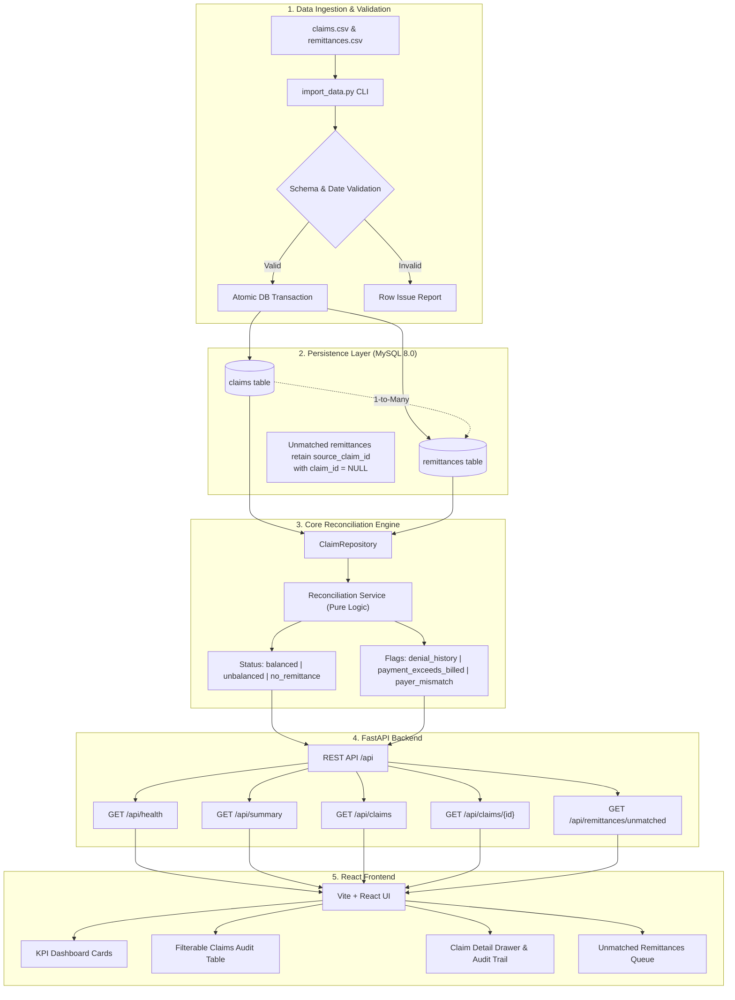

# Stitch Financial — Claim Reconciliation Engine

[](http://67.202.41.44:3000)
[](https://github.com/nakul143naps/claim-reconciliation)
[](https://github.com/nakul143naps/claim-reconciliation)

> 🌐 **Live AWS Deployment**: [http://67.202.41.44:3000](http://67.202.41.44:3000)  
> 📖 **Interview Master Guide & Top 20 SQL Queries**: [`INTERVIEW_MASTER_GUIDE.md`](./INTERVIEW_MASTER_GUIDE.md)  
> 📋 **Machine Transfer & Complete Architecture**: [`PROJECT_HANDOFF.md`](./PROJECT_HANDOFF.md)  
> 🎯 **Quick Defense Cheatsheet**: [`INTERVIEW_PREP_CHEAT_SHEET.md`](./INTERVIEW_PREP_CHEAT_SHEET.md)

---

A production-grade claims reconciliation and audit platform designed for healthcare billing operations. This system ingests medical billing claims and payer remittances, calculates claim-level balances with deterministic integer arithmetic, preserves complete remittance audit trails (including prior denial history), and isolates orphaned payments.

---

## 1. System Architecture & Flow



---

## 2. Core Business Rules & Financial Precision

### 2.1 Integer Cents Only
Floating-point arithmetic (e.g. `0.1 + 0.2`) introduces binary rounding errors. In financial systems, all currency is represented and persisted as integer cents (`BIGINT` in MySQL, integer types in Python/TypeScript). Display formatting to dollars/rupees happens strictly in the UI layer.

### 2.2 Reconciliation Formula
For any claim with at least one matched remittance:
$$\text{Difference} = \text{Billed Cents} - \sum \text{Paid Cents} - \sum \text{Adjustment Cents} - \sum \text{Patient Responsibility Cents}$$

### 2.3 Status Decision Tree
* **`balanced`**: At least one matched remittance exists and $\text{Difference} = 0$.
* **`unbalanced`**: At least one matched remittance exists and $\text{Difference} \neq 0$ (including negative balances).
* **`no_remittance`**: No remittance advice has been received. The difference is explicitly `null` (not $0 or billed amount), preventing false assumptions of collectible debt.

### 2.4 Denial History vs. Financial Status
Assignment denial codes: **`CO-16`**, **`CO-50`**, and **`CO-197`**.
* A claim can be mathematically **`balanced`** and still have a **`denial_history`** flag if an earlier remittance was rejected before being resolved (e.g. claim `C1007`).
* Contractual adjustment codes like **`CO-45`** are standard write-offs and are not treated as denials.

### 2.5 Orphaned (Unmatched) Remittances
When a payer sends payment for an unknown claim (e.g. remit `R1012` referencing `C9999`):
* The record is **never discarded** and **no fake claim is invented**.
* `source_claim_id` stores `"C9999"` while the foreign key `claim_id` is set to `NULL`.
* The cash is tracked in `all_remittance_paid_cents` ($1,040.00) while isolated from `matched_paid_cents` ($990.00) so valid claims remain accurate.

---

## 3. Tech Stack

* **Backend**: Python 3.13, FastAPI, SQLAlchemy 2.0, Pydantic v2, PyMySQL, Cryptography, python-multipart.
* **Database**: MySQL 8.0 (Dockerized container `claim_reconciliation_db`) with persistent volumes and healthcheck; SQLite with `StaticPool` for fast in-memory testing.
* **Frontend**: React 18, TypeScript, Vite, Lucide Icons, Accessible High-Contrast CSS.
* **Testing**: Pytest, FastAPI TestClient, HTTPX (38 automated unit, integration, and scale tests).

---

## 4. Key Platform Features

* **3-Way Settlement Ledger**: Visualizes Gross Cash Collected ($990.00 / 58.2%), Contractual Write-offs ($140.00), Patient Responsibility ($75.00), and Net Unsettled AR ($495.00).
* **Interactive CSV Batch Ingestion**: Drag-and-drop file upload for Claims and Remittances with live row-by-row validation, duplicate skipping, and automatic orphan re-linking regardless of upload order.
* **1-Click Safety Net ("Reset to Demo Benchmark")**: Instantly flushes test data and restores the official 12 claims / 13 remittances benchmark in milliseconds.
* **Scale Testing & Pagination Engine**: Tested with both the canonical 12-claim benchmark and an isolated 50-claim enterprise dataset (`data/claims_large.csv`) supporting `Show: 10 / 20 / 50` entries per page.
* **Clinical Denial Appeal Playbook**: Drilldown modal for claims with historical denials (`CO-16`, `CO-50`, `CO-197`) providing root-cause guidance and copyable formal appeal letters.
* **Multi-Format Export Engine**: One-click export to CSV, JSON, and Print/PDF.

---

## 5. Repository Structure

```text
claim_reconciliation_docs/
├── backend/
│   ├── app/
│   │   ├── api/             # HTTP endpoints (/health, /summary, /claims, /remittances)
│   │   ├── core/            # Configuration management & environment settings
│   │   ├── db/              # SQLAlchemy models, connection engine & sessions
│   │   ├── repositories/    # Query aggregation, eager-loading & filtering
│   │   ├── schemas/         # Pydantic request/response & error contracts
│   │   ├── scripts/         # CSV import CLI (import_data.py)
│   │   ├── services/        # Pure reconciliation logic & CSV validation
│   │   └── main.py          # FastAPI application & error middleware
│   ├── tests/
│   │   ├── unit/            # Math, status, denial codes & import tests
│   │   ├── integration/     # Full HTTP API integration tests
│   │   └── conftest.py      # SQLite in-memory fixtures
│   ├── requirements.txt
│   ├── .env.example
│   └── .env
├── frontend/
│   ├── src/
│   │   ├── api/             # Centralized typed API client
│   │   ├── components/      # KPI cards, status badges, tables, detail drawer
│   │   ├── types/           # TypeScript interfaces matching backend schemas
│   │   ├── utils/           # Currency and date formatters
│   │   ├── App.tsx          # Root dashboard view & state orchestration
│   │   └── main.tsx
│   ├── package.json
│   ├── vite.config.ts
│   └── tsconfig.json
├── data/
│   ├── claims.csv           # 12 synthetic claims
│   ├── remittances.csv      # 13 synthetic remittances
│   └── generate.py          # Deterministic CSV generator
├── docs/                    # Complete PRD, Architecture, Rules, Design, Tasks, Memory
├── docker-compose.yml       # MySQL 8.0 service definition
├── pytest.ini               # Test suite configuration
└── README.md
```

---

## 6. Quickstart Guide

### Prerequisites
* **Docker Desktop** (or native MySQL 8.0)
* **Python 3.11+**
* **Node.js 18+** & npm

### Step 1: Start MySQL Database
```bash
docker compose up -d
```
Verify the container is healthy:
```bash
docker ps
```

### Step 2: Set Up Backend
```bash
# Navigate to backend directory
cd backend

# Create and activate virtual environment
python -m venv .venv

# Windows:
.venv\Scripts\activate
# Linux/macOS:
# source .venv/bin/activate

# Install dependencies
pip install -r requirements.txt

# Run database import script (seeds benchmark 12 claims / 13 remittances)
python -m backend.app.scripts.import_data
```

### Step 3: Run Backend API Server
```bash
# From project root with .venv activated:
uvicorn backend.app.main:app --reload --port 8000
```
* Interactive API Documentation (Swagger): [http://localhost:8000/docs](http://localhost:8000/docs)
* Health Check: [http://localhost:8000/api/health](http://localhost:8000/api/health)

### Step 4: Run Frontend Application
```bash
cd frontend
npm install
npm run dev
```
Open your browser at: [http://localhost:3000](http://localhost:3000)

---

## 7. Automated Testing

The project includes **38 automated unit, integration, and scale tests** covering calculation formulas, duplicate handling, schema validation, HTTP error codes, orphan quarantine, and 50-claim pagination invariants.

```bash
# Run full test suite from project root:
pytest -v
```

---

## 8. AWS Cloud Deployment Architecture

The platform is deployed live on **Amazon Web Services (AWS)** at:  
👉 **[http://67.202.41.44:3000](http://67.202.41.44:3000)**

### 8.1 Cloud Infrastructure Specifications
* **Cloud Provider**: Amazon Web Services (AWS)
* **Compute Instance**: EC2 `t3.micro` (2 vCPUs, 1 GiB Physical RAM)
* **Region**: `us-east-1` (N. Virginia)
* **Operating System**: Ubuntu 24.04 LTS
* **Storage**: 20 GiB General Purpose SSD (gp3 EBS Volume) + 2 GiB Swapfile
* **Security Group Inbound Rules**:
  - `SSH` (Port 22) ➔ Admin terminal access
  - `HTTP` (Port 80) ➔ Standard web access
  - `Custom TCP` (Port 3000) ➔ React Vite Frontend Dashboard
  - `Custom TCP` (Port 8000) ➔ FastAPI REST API Service

### 8.2 Systems Engineering & Challenges Overcome

#### 1. Dynamic EBS Disk Expansion (Resolving 8 GB Exhaustion)
* **The Problem**: Default AWS EC2 Ubuntu instances provision with only an 8 GB root volume. After pulling the MySQL 8.0 Docker image, installing build tools, and apt packages, disk utilization reached 99% (`134 MB available`), blocking Node package compilation.
* **The Engineering Fix**: We modified the AWS EBS volume online from 8 GB to 20 GB (leveraging the 30 GB AWS Free Tier allowance). In the Linux shell, we resized the live partition on-the-fly without downtime:
  ```bash
  sudo growpart /dev/xvda 1
  sudo resize2fs /dev/root
  ```
  This immediately unlocked over 13 GB of free storage.

#### 2. Virtual Memory Allocation (2 GB Swapfile)
* **The Problem**: `t3.micro` instances provide 1 GiB of physical RAM. Running Dockerized MySQL 8.0 (~350 MB) and executing Node.js `npm install` (~500 MB) concurrently caused memory exhaustion and kernel throttling.
* **The Engineering Fix**: We provisioned a 2 GiB swapfile on the fast NVMe/gp3 SSD:
  ```bash
  sudo fallocate -l 2G /swapfile
  sudo chmod 600 /swapfile
  sudo mkswap /swapfile
  sudo swapon /swapfile
  ```
  This expanded total usable memory to 3 GiB, permanently preventing Out-Of-Memory (OOM) freezes.

#### 3. Containerized MySQL 8.0 Persistence
* MySQL runs in an isolated container managed by Docker Compose with persistent data volume `mysql_data:/var/lib/mysql`.
* Healthchecks query `mysqladmin ping` every 5 seconds.
* Relational constraints, non-negative checks, and foreign keys (`ON DELETE SET NULL`) enforce financial integrity on the host.

#### 4. Background Process Daemonization
Both the FastAPI application and the Vite frontend are managed with process isolation:
```bash
# Backend Daemon:
nohup backend/.venv/bin/uvicorn backend.app.main:app --host 0.0.0.0 --port 8000 > backend.log 2>&1 &

# Frontend Daemon:
nohup npm run dev > frontend.log 2>&1 &
```

---

## 9. What I Would Build Next in Production (Forward Deployed Engineer Perspective)

1. **Chunked Streaming CSV Pipeline**:
   * For enterprise hospital networks generating multi-gigabyte 835/837 EDI or CSV files, stream processing using Python iterators or Celery/Temporal workers with idempotency keys prevents Out-Of-Memory (OOM) failures.
2. **Audit Logging & Event Sourcing**:
   * Store immutable reconciliation event ledgers so every payment allocation change has a cryptographic timestamp and user attribution.
3. **Automated Denial Appeal Assistant**:
   * For claims flagged with denial codes (`CO-16`, `CO-50`, `CO-197`), automatically generate appeal packets pre-populated with required clinical documentation and payer-specific guidelines.
4. **Distributed Observability**:
   * Add OpenTelemetry tracing and Prometheus metrics to monitor API latency, batch ingestion duration, and database connection pool saturation.

---

## 10. AI Tool Attribution

In accordance with the assignment instructions:
* AI assistance (Google DeepMind Antigravity) was used during this take-home to assist in drafting architectural specifications, structuring edge-case unit test fixtures, and accelerating frontend component styling. All business logic, database constraints, calculations, and code implementations were reviewed and verified for production correctness.
